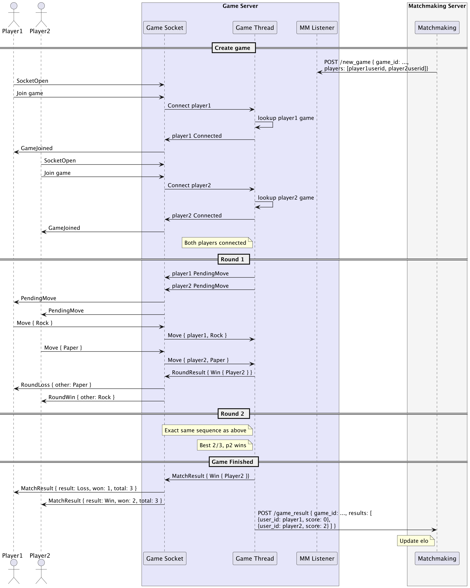

# Websocket game server

This project was used to explore Rust and WebSockets.


## Project layout

| Path | Purpose |
| --- | --- |
| `src/common` | Shared models, messages and websocket helpers |
| `src/matchmaking-server` | Queues players and pairs them into games |
| `src/game-server` | Runs rock-paper-scissors games over websockets |
| `src/agent` | Automated players and their strategies |
| `src/web-client` | Next.js UI for testing matchmaking |
| `docs` | Sequence diagrams and design notes |

## Running locally

```bash
cargo run -p matchmaking-server
cargo run -p game-server
cd src/web-client && pnpm install && pnpm dev
```

See [docs/architecture.md](docs/architecture.md) for how the pieces fit together.

## Roadmap

### MVP1 - Matchmaking + stress test

- [x] Implement naive 1-1 matchmaking
- [x] Create rock-paper-scissors socket server
- [x] Create rock-paper-scissors web client
- [x] Deploy & stress test
- [/] Create agents to play rock paper scissors agents
- [ ] Implement ELO matchmaking
- [ ] Persist match history
- [ ] Add spectator mode
